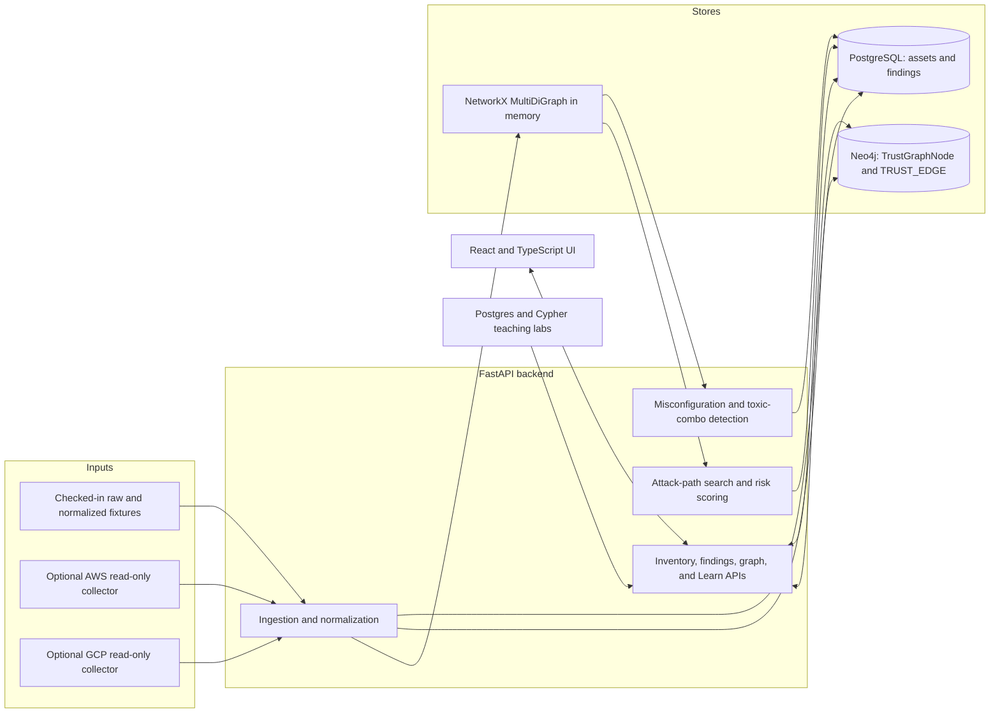
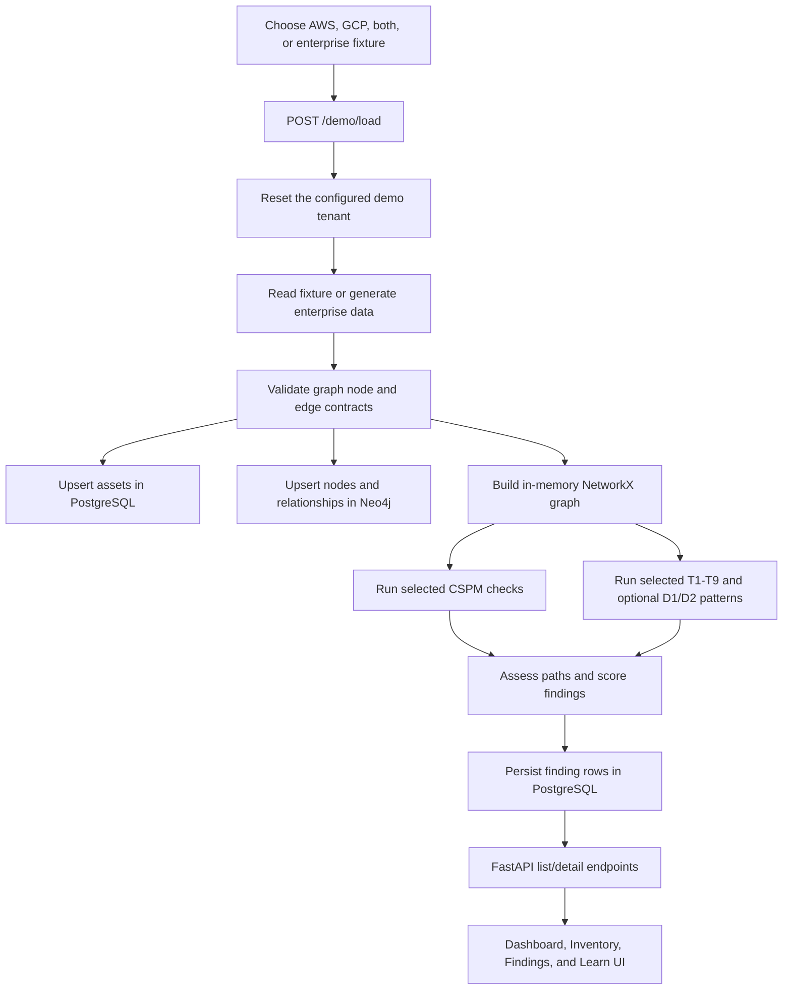
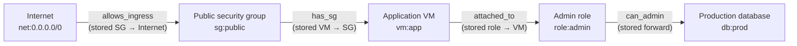
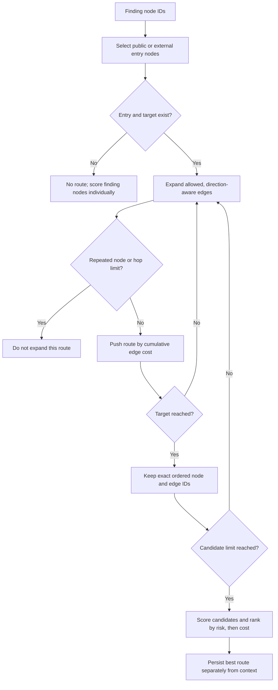
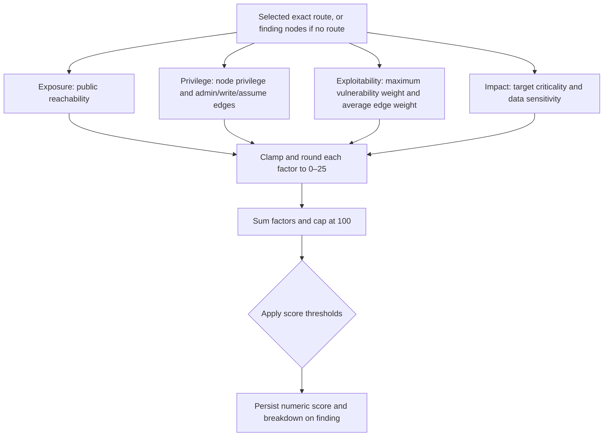

# NetraOM CSPM Trust Graph — Project Documentation

> **Scope and evidence.** This guide describes the repository as inspected on **2026-10-10**. “Implemented” means the behavior is present in source; it does not mean that a live cloud account, production security, or every deployment path was tested. Cloud services and competitor capabilities are identified as limited, simulated, or vendor-documented where appropriate.

## Table of contents

1. [Project Overview](#1-project-overview)
2. [Features and Status](#2-features-and-status)
3. [Technology Stack](#3-technology-stack)
4. [Architecture and Data Flow](#4-architecture-and-data-flow)
5. [Attack-Path Algorithm](#5-attack-path-algorithm)
6. [Risk Scoring](#6-risk-scoring)
7. [Detection Engine](#7-detection-engine)
8. [Cloud Collectors](#8-cloud-collectors)
9. [Database and API](#9-database-and-api)
10. [Setup and Testing](#10-setup-and-testing)
11. [Limitations and Security Notes](#11-limitations-and-security-notes)
12. [Orca Security and Wiz Comparison](#12-orca-security-and-wiz-comparison)
13. [Summary and Glossary](#13-summary-and-glossary)

---

## 1. Project Overview

NetraOM CSPM Trust Graph is a **local, educational cloud-security-posture demo**. It illustrates how inventory, configuration checks, graph relationships, attack-path analysis, and findings can fit together. It is not a deployed commercial CSPM service.

### Problem it demonstrates

A cloud configuration issue can matter more when an attacker can reach it through network exposure and identity permissions, especially if the destination contains important data. The project uses:

- PostgreSQL for inventory and finding records that are easy to list, filter, and inspect.
- Neo4j for a directed trust graph and neighborhood queries.
- An in-memory NetworkX graph for local relationship and attack-path analysis.
- A React UI and teaching labs to inspect the resulting records and graph.

### Intended users

- Students and instructors learning CSPM, graph relationships, and attack-path analysis.
- Developers evaluating an example FastAPI + PostgreSQL + Neo4j + React architecture.
- Security practitioners who want a small, fixture-driven prototype to explore.

### Practical use case

Start the local services, load the AWS fixture, and inspect a finding for world-open SSH. The demo can show the internet CIDR, security group, compute instance, attached identity, and a storage destination connected by permissions. The same finding is visible in the API, PostgreSQL lab, and graph-oriented UI.

**Data warning:** The checked-in fixtures are synthetic examples with placeholder account/resource identifiers. The main UI's demo load buttons use fixtures; they are not live AWS/GCP scans.

## 2. Features and Status

| Feature | Status | What the repository currently does |
|---|---|---|
| Dashboard and inventory | **Implemented for the demo** | Displays the demo tenant's assets, facets, and findings; supports fixture loading and asset detail. |
| Enterprise demo scenario | **Implemented, synthetic** | Generates a roughly 500-asset fixture through `generate_enterprise_fixture`; it is not a real enterprise account scan. |
| AWS/GCP bundled scenarios | **Implemented, synthetic** | Loads checked-in normalized AWS/GCP fixtures through `/demo/load`. |
| AWS/GCP cloud inventory | **Implemented but limited** | Optional read-only collectors are available through a CLI. They cover a limited resource set and write into the local stores. Their output is not exposed through the regular demo-tenant API/UI. |
| CSPM misconfiguration checks | **Implemented, rule-based** | Checks selected public storage, network ingress, database, API Gateway, load balancer, and Lambda conditions. It is not a full cloud benchmark/compliance engine. |
| Toxic-combination detection | **Implemented, bounded rule catalog** | Has T1–T9 patterns, with only a subset enabled for small fixture loads by default. Extra D1/D2 rules are demo patterns. |
| Attack-path discovery | **Implemented, bounded prototype** | Uses the explicit traversal policy and bounded priority-queue search described in [Section 5](#5-attack-path-algorithm). |
| Four-factor risk score | **Implemented, heuristic** | Assigns exposure, privilege, exploitability, and impact subscores from 0–25 and sums them. It is not a calibrated or externally validated risk model. |
| Findings route evidence | **Implemented** | Findings can store exact route nodes, edge IDs, and path edges separately from graph-neighborhood context. |
| PostgreSQL and Cypher teaching labs | **Implemented with restrictions** | Provides read-oriented templates and validation guards; these are educational APIs, not general database consoles. |
| Threat map | **Mocked / simulated** | Uses finding-derived illustrative locations or a labeled fallback dataset; it is not a live threat-intelligence feed. |
| Dashboard inventory history | **Partial, browser-local** | The recent UI addition records daily current counts in browser `localStorage`, only when Dashboard is visited. It is not server-shared or retroactive. |
| Production authentication / tenant UX | **Missing from the demo** | Main portal/API routes use the configured demo tenant and expose no end-user login flow. |
| Auto-remediation | **Missing** | The UI may present analyst guidance/status, but it does not change cloud resources or open remediation tickets. |
| Broad compliance mapping, continuous monitoring, runtime detection | **Missing** | No complete framework benchmark, event-driven scanner, workload sensor, or production runtime detection system is implemented. |

The frontend is a browser UI, not evidence that integrations have been exercised against actual provider accounts.

## 3. Technology Stack

| Technology | Purpose in this repository |
|---|---|
| Python 3.11+ | Backend and optional collector code. |
| FastAPI / Uvicorn | JSON API, interactive OpenAPI/Swagger docs, and local server. |
| Pydantic | Typed graph contract models and API request models. |
| SQLAlchemy + psycopg | PostgreSQL models and persistence. |
| PostgreSQL 16 | Relational asset and finding tables. |
| Neo4j 5 | Persistent property graph used by the demo and graph query labs. |
| NetworkX `MultiDiGraph` | In-memory graph used by combo analysis and attack-path traversal; preserves parallel edge IDs. |
| React 19 + TypeScript + Vite | Single-page UI and build system. |
| `@xyflow/react` | Interactive graph rendering used in the asset/finding graph canvas. |
| Tailwind CSS 4 | UI utility styling. |
| Recharts | Dashboard charts. |
| Docker Compose | Local orchestration for Neo4j, PostgreSQL, API, Adminer, and UI. |
| boto3 (optional) | AWS collector SDK; uses the normal boto3 credential chain. |
| Google Cloud client libraries (optional) | GCP collector APIs; uses Application Default Credentials (ADC). |
| pytest | Backend unit and integration-oriented tests. |

See [backend/pyproject.toml](backend/pyproject.toml), [ui/package.json](ui/package.json), and [docker-compose.yml](docker-compose.yml).

## 4. Architecture and Data Flow

### System architecture



### End-to-end fixture flow



The sequence is visible in `demo_load()` and `_run_detection()` in [backend/app/main.py](backend/app/main.py), `ingest_fixture_dict()` in [backend/app/ingest.py](backend/app/ingest.py), and `evaluate_and_persist_combos()` in [backend/app/combos.py](backend/app/combos.py).

### Important implementation details

- Fixture records are validated as `TrustGraphNode` / `TrustGraphEdge` contract models.
- Asset rows are upserted by tenant and graph node ID. Their `graph_node_id` is the bridge to graph nodes.
- Neo4j stores nodes labeled `TrustGraphNode` and directed relationships typed `TRUST_EDGE`, with `kind`, `edge_id`, and `props`.
- `NetworkXTrustGraph` uses `networkx.MultiDiGraph`; its edge key is the edge ID, so parallel edges can be retained for analysis.
- The cloud collector CLI feeds its normalized bundle through the same ingestion and detection path, but uses a distinct cloud tenant ID.

## 5. Attack-Path Algorithm

### Graph model and traversal directions

Node kinds in the graph contract are account, identity, resource, network, and external. Edges are directed and typed. The policy in `ATTACK_TRAVERSAL_POLICY` (`backend/app/attack_path_engine.py`) decides how each supported stored relationship is traversed; it does not rewrite the canonical stored relationship.

| Relationship kind | Attacker traversal policy |
|---|---|
| `in_vpc`, `in_subnet`, `attached_to`, `has_sg`, `exposes` | Reverse stored direction |
| `owns`, `contains`, `uses`, `can_assume`, `can_read`, `can_write`, `can_admin`, `grants`, `trusts`, `federates_to`, `allows_ingress`, `allows_egress`, `resolves_to`, `serves`, `redirects_to`, `runs_image`, `deploys` | Forward stored direction, with special handling for `allows_ingress` |
| Unknown relationship kinds | Not traversed by the attack-path engine |

For `allows_ingress`, a world/public endpoint can change the traversal direction. Thus a stored `security group → net:0.0.0.0/0` edge is traversed from internet to security group, while a relationship already stored in attacker order remains forward.

`path_edges_for_route()` resolves every route edge by its exact edge ID and emits both canonical endpoints and traversal endpoints. `ordered_route_node_ids()` reconstructs node order only from a complete ordered route, not from an unordered set of finding nodes.

### Search, bounds, and ranking

The finding scorer calls `assess_finding_path()`:

1. It sorts and deduplicates the finding's node IDs.
2. It identifies possible entry nodes **among those finding nodes**: IDs starting `net:` or `ext:`, external-kind nodes, or nodes marked public/internet-exposed.
3. For every entry and every other finding node, it calls `find_rank_paths_dijkstra()`.
4. Search enumerates simple paths using a min-heap ordered by cumulative traversal cost. A path may not revisit a node.
5. It stops after the hop bound (default **8**) and candidate bound (default **10** per source-target search).
6. Candidate paths discovered within that cost bound are scored independently. The final ordering is descending risk score, then ascending traversal cost, then lexical node and edge IDs.
7. If no route is found, the finding remains and receives the highest single-node score among its finding nodes. The unordered node collection is not described as a route.

For each edge, the traversal cost uses the edge-kind weight and the **destination traversal node's** vulnerability weight:

```text
risk_factor = max(0.01, relationship_weight × destination_vulnerability_weight)
edge_cost   = -ln(risk_factor) + 0.05
path_cost   = sum(edge_cost for each edge)
```

Lower costs enter the heap first. The implementation is a bounded, Dijkstra-style **simple-route enumerator**: its cost state key includes the complete node and edge-ID sequence. It is not A* (there is no target heuristic), and BFS is not the route search used by finding scoring. A separate BFS candidate-path helper exists.

Because the candidate limit is applied while discovering routes by traversal cost **before** risk sorting, a high-risk route that is relatively expensive can be excluded if more than the limit of cheaper candidates are found. Traversal cost is not the risk score.

### Pseudocode

```text
find_rank_paths(source, target):
    heap = [(cost=0, nodes=[source], edge_ids=[])]
    candidates = []

    while heap is not empty:
        route = pop route with smallest cumulative cost

        if route reaches target:
            keep route
            stop if candidate limit reached
            continue

        if route edge count reached max hops:
            continue

        for each allowed outgoing attacker-traversal edge, in stable order:
            if next node already occurs in route.nodes:
                continue
            push(route + edge, cost + calculated edge cost)

    resolve exact edge IDs for each candidate
    score each candidate with four independent risk factors
    return candidates ordered by risk descending, cost ascending, then IDs
```

### Example route

The following is an illustrative route consistent with the checked-in traversal policy; the displayed arrows describe attacker movement, which can oppose canonical edge storage:



The corresponding ordered nodes are `Internet → SG → VM → role → database`. The route retains one exact edge ID per hop, even when the traversal direction differs from the stored edge direction. Finding neighborhood edges are separate context and must not be treated as traversed steps.

### Search flow diagram



Source references: `ATTACK_TRAVERSAL_POLICY`, `_attacker_adjacency()`, `calculate_edge_cost()`, `find_candidate_paths_bfs()`, `find_rank_paths_dijkstra()`, and `assess_finding_path()` in [backend/app/attack_path_engine.py](backend/app/attack_path_engine.py); exact edge/path helpers in [backend/app/graph_utils.py](backend/app/graph_utils.py).

## 6. Risk Scoring

### Formula actually used

The scorer computes four integer subscores, each bounded to 0–25, then adds them:

```text
final_score = min(100, exposure + privilege + exploitability + impact)
```

Subscores use Python `round()` and are clamped to 0–25. Severity thresholds are:

| Score | Severity |
|---:|---|
| 90–100 | Critical |
| 70–89 | High |
| 40–69 | Medium |
| 0–39 | Low |

| Factor | Actual calculation and inspected inputs |
|---|---|
| **Exposure** | Find the maximum node exposure weight along the route. Multiply by 1.0 if the first route node is `net:` or marked public/internet-exposed; otherwise multiply by 0.7. Multiply by 25, round, and clamp. The weight helper uses 1.0 for a node marked either public or internet-exposed, 0.7 for `in_public_subnet`, and 0.2 otherwise. Although the config lists a separate 0.9 public weight, the helper currently maps both public and exposed flags to 1.0. |
| **Privilege** | Let `P` be the maximum node privilege weight and `E` the maximum relationship weight among `can_admin`, `can_write`, and `can_assume` edges (0 if none). Score `round((0.7P + 0.3E) × 25)`. Node weights include admin flags = 1.0, can-write = 0.75, can-read = 0.4, identity-kind = 0.5, otherwise 0.2. |
| **Exploitability** | Let `V` be the maximum vulnerability-severity weight on route nodes and `R` the average relationship weight on route edges (0.8 when no edges). Score `round((0.5V + 0.5R) × 25)`. Severity weights are Critical 1.0, High 0.75, Medium 0.5, Low 0.25, None 0.0; an unrecognized severity falls back to 0.2. |
| **Impact** | Use the final route node as target. Let `C` be its criticality weight and `S` its data-sensitivity weight. Score `round((0.6C + 0.4S) × 25)`. Criticality includes crown-jewel 1.0, production 0.85, staging 0.5, development 0.2, default 0.3. Sensitivity includes critical-data/PII 1.0, confidential 0.7, internal 0.3, otherwise 0.0. |

Weights are centralized in [backend/app/risk_config.py](backend/app/risk_config.py); calculation and severity thresholds are in `evaluate_path_risk_breakdown()` in [backend/app/attack_path_engine.py](backend/app/attack_path_engine.py).

### Worked example

Assume the illustrative five-node route in [Section 5](#5-attack-path-algorithm) has:

- An internet entry.
- A Critical-severity vulnerable VM.
- An admin-capable role and a `can_admin` edge.
- A crown-jewel database marked critical data/PII.
- Edge kinds `allows_ingress`, `has_sg`, `attached_to`, `can_admin`. The unlisted `has_sg` relationship uses the configured default weight of 0.50.

Then, using the code's weights:

```text
Exposure        = round(1.00 × 1.00 × 25) = 25
Privilege       = round((1.00 × 0.70 + 0.95 × 0.30) × 25) = 25
Average edge R  = (0.95 + 0.50 + 0.85 + 0.95) / 4 = 0.8125
Exploitability  = round((1.00 × 0.50 + 0.8125 × 0.50) × 25) = 23
Impact          = round((1.00 × 0.60 + 1.00 × 0.40) × 25) = 25
Final           = min(100, 25 + 25 + 23 + 25) = 98 → CRITICAL
```

These values are a transparent example calculation, **not** a measured production calibration.

### Risk-scoring flow



Risk score and traversal cost answer different questions: the first is the code's finding-risk heuristic; the second orders route candidates during search.

## 7. Detection Engine

### CSPM misconfiguration rules

`evaluate_misconfigs()` in [backend/app/misconfig.py](backend/app/misconfig.py) evaluates the records it is passed and persists one deduplicated finding per fingerprint. The inspected rule conditions include:

| Rule family / IDs | Condition represented |
|---|---|
| `aws_s3_public_read`, `gcp_storage_public_read` | S3/GCS object storage is public or has anonymous read/write metadata. |
| `storage_public_anonymous_write` | S3/GCS is marked anonymous-write. |
| `storage_public_unencrypted` | Public S3/GCS storage is explicitly marked unencrypted. |
| `aws_apigw_public_no_auth` | API Gateway authorization is `NONE`. |
| `aws_alb_public_internet`, `aws_nlb_public_internet` | Load balancer is internet-facing/public. |
| `aws_rds_public_exposure` | RDS instance/cluster is publicly reachable. |
| `aws_lambda_public_invoke` | Lambda is marked public/internet-exposed. |
| `aws_sg_world_ssh`, `gcp_firewall_world_ssh` | Ingress from world CIDR on port 22. |
| `aws_sg_world_rdp` | Ingress from world CIDR on port 3389. |
| `aws_sg_world_web` | Ingress from world CIDR on port 80 or 443. |

These are selected property/rule checks, not exhaustive cloud-provider policy coverage. An absent/unknown property can lead to different behavior than an explicit false value; for example, T6's combo condition treats a public resource as unencrypted unless `is_encrypted` is exactly true.

### Toxic combinations

`PATTERN_REGISTRY` in [vendor/netraom-graph-writer/src/netraom_graph_writer/combo/patterns.py](vendor/netraom-graph-writer/src/netraom_graph_writer/combo/patterns.py) defines:

| ID | High-level pattern |
|---|---|
| T1 | Public writable storage and a write-capable identity. |
| T2 | Internet SSH ingress to compute, an attached role, and writable public/critical storage. |
| T3 | A resource exposes an external surface. |
| T4 | Cross-cloud federation/assumption relationship. |
| T5 | Internet-reachable compute with an attached role that can access critical data. |
| T6 | Public storage without an explicit `is_encrypted: true`. |
| T7 | Public RDS/Redshift database. |
| T8 | Public function with a role that can read secrets. |
| T9 | Internet-reachable compute with a role having a `can_admin` edge. |

The normal `/demo/load` flow selects only **T1, T2, T5, T6, T9** for small AWS or GCP fixtures. `both` and `enterprise` request all T1–T9. The enterprise demo additionally enables **D1** (unauthenticated API Gateway to sensitive writable data) and **D2** (public load-balancer/exposed compute to exposed data) through `evaluate_extra_demo_patterns()` in [backend/app/combos_demo.py](backend/app/combos_demo.py). The cloud collector CLI also enables all patterns and the demo patterns.

Patterns are heuristics with specific node IDs, properties, and edge conventions. In particular, some shared combo helpers match AWS-style role IDs and may not recognize every GCP service-account naming shape. Passing a test fixture does not establish complete cross-cloud coverage.

### Finding creation and fingerprints

- Misconfiguration fingerprints are stable hashes based on rule ID and canonical key; non-demo tenant IDs are included in the hash material (`_fp()` in `misconfig.py`).
- Toxic-combo fingerprints are stable hashes based on pattern ID and sorted matching node IDs; non-demo fingerprints are tenant-scoped in `combos.py`.
- Detection findings are assessed against the in-memory graph before persistence. The path and risk breakdown are attached to the stored finding row.
- `trust_graph_node_ids` identify finding-related nodes. `path_edges`, `attack_path_nodes`, and `attack_path_edge_ids` represent a selected, ordered path when one exists.

## 8. Cloud Collectors

Collectors are optional modules run explicitly through `python -m app.cloud_collectors.cli`. They are not called by the UI's demo fixture buttons or by a continuous scheduler. Provider API access is read-only; collected records are written to the application's PostgreSQL and Neo4j stores.

| Cloud | Implemented resource scope |
|---|---|
| **AWS** | S3 bucket list, location, policy, policy status, public access block, ACL, and bucket encryption configuration; EC2 instances, security groups, ingress rules, subnet/SG/instance-profile relationships; IAM roles, attached role policies, instance profiles, and IAM policy simulation for selected S3 object read/write actions. EC2 inventory uses the selected region; S3 and IAM resources are account-level. |
| **GCP** | Cloud Storage buckets and bucket IAM bindings; Compute Engine zones/instances, ingress firewall rules and target matching; service accounts and project IAM policy. Project IAM role mapping is limited to selected Cloud Storage reader/writer/admin roles. |

### Authentication and permissions

- AWS calls use `boto3.Session()` without explicit credentials, relying on the standard environment/profile/role credential chain. Supply a region with `AWS_DEFAULT_REGION` or `--region`.
- GCP uses Application Default Credentials through `google.auth.default()` and a read-only Cloud Platform OAuth scope. A project ID is required.
- The detailed read-only permission lists and commands are in [backend/README.md](backend/README.md). The implementation does not accept cloud secrets as CLI parameters.
- Cloud records use `CLOUD_TENANT_ID` (default UUID `22222222-2222-4222-8222-222222222222`), distinct from `DEMO_TENANT_ID`. This protects them from the demo reset/load flow. However, the standard asset/finding APIs still filter to the demo tenant, so cloud-collected data is not currently presented by those API routes/UI.

### Collector limitations

`backend/README.md` documents important caveats:

- Repeated collection uses stable resource/edge IDs and upserts; it does not remove resources that disappeared from the provider scope.
- AWS IAM simulation materializes only selected S3 object read/write decisions for buckets in the collected scope. It does not enumerate all effective permissions.
- AWS account-level S3 Block Public Access settings and bucket policy conditions are not evaluated. Object-level encryption is not enumerated; missing bucket encryption configuration remains unknown.
- GCP public-instance exposure is an approximation from public IPs plus matching enabled ingress/firewall rules. Firewall deny/priority interactions, inherited Public Access Prevention, and conditional IAM bindings are not evaluated.
- GCP service-account OAuth scopes are recorded but do not constrain generated IAM permission edges.
- Collectors have mock-based tests, but those do not prove live credentials, permissions, quotas, API behavior, or correctness across all resource configurations.

## 9. Database and API

### PostgreSQL tables

The schema is defined in [docker/postgres/01-schema.sql](docker/postgres/01-schema.sql) and mapped in [backend/app/db/models.py](backend/app/db/models.py).

| Table | Important fields | Purpose |
|---|---|---|
| `assets` | `asset_id`, `tenant_id`, `graph_node_id`, `canonical_key`, display/cloud/type/region, `is_internet_exposed`, `props`, `last_seen` | Portal-style inventory. `(tenant_id, graph_node_id)` is the logical unique key in the SQL schema. |
| `findings` | `fingerprint`, tenant/source/rule/title/description/severity, `trust_graph_node_ids`, `path_edges`, `risk_score`, `score_breakdown`, `status`, `last_seen` | CSPM and toxic-combo results, including optional route and factor breakdown. |

There is no inventory history/snapshot table in this schema. The Dashboard history chart is browser-local.

### Neo4j and graph contract

- Nodes: label `TrustGraphNode`, with tenant and node IDs, kind, name, cloud, resource type, region, and serialized properties.
- Edges: directed `TRUST_EDGE` relationships with `edge_id`, `kind`, and properties.
- The startup handler creates a uniqueness constraint on `(tenant_id, node_id)`.
- The contract models and accepted node/edge enums are in [vendor/netraom-contracts/src/netraom_contracts/models/graph.py](vendor/netraom-contracts/src/netraom_contracts/models/graph.py) and the adjacent `enums.py`.
- The in-memory test/analysis graph is `NetworkXTrustGraph`, a `MultiDiGraph`, not the Neo4j database itself.

### Main API routes

The customer-style routes below are declared in [backend/app/main.py](backend/app/main.py). The teaching `/learn` router is hidden from the generated OpenAPI schema.

| Route | Purpose |
|---|---|
| `GET /health` | Basic process health response. |
| `POST /demo/load` | Reset and load one of `aws`, `gcp`, `both`, `enterprise` into the demo tenant; run detections. |
| `POST /demo/reset` | Clear demo-tenant graph, assets, and findings. |
| `GET /assets/facets`, `GET /assets` | Inventory counts/facets and paginated/filtered assets. |
| `GET /assets/by-node/{graph_node_id}`, `GET /assets/{asset_id}`, `GET /assets/{asset_id}/json` | Look up an asset, including its normalized/raw/graph representation where available. |
| `GET /graph/nodes/{node_id}/neighborhood`, `GET /graph/schema` | Read graph neighborhood or supported graph-kind names. |
| `GET /findings/facets`, `GET /findings` | Finding counts, filtering, sorting, and pagination. |
| `GET /findings/{fingerprint}/path` | Return finding, graph context, related assets, exact ordered route nodes/edges, and score data. |
| `GET /learn/inventory/*`, `GET /learn/stats`, `GET /learn/postgres/*`, `POST /learn/sql`, `GET /learn/cypher/*`, `POST /learn/cypher` | Teaching fixture, statistics, SQL, and Cypher endpoints. |

The API's path response intentionally returns both `edges` (neighborhood/context) and `attack_path_edges` (the selected route). Consumers should use the exact path arrays for route highlighting.

### Frontend pages

Routes in [ui/src/App.tsx](ui/src/App.tsx):

| Page | Route | Purpose |
|---|---|---|
| Dashboard | `/` | Fixture loading, inventory/finding metrics, charts, recent findings. |
| Inventory | `/assets` | Search and filter assets. |
| Asset detail | `/assets/:assetId` | Asset properties and graph neighborhood. |
| Findings | `/findings` | CSPM/toxic-combo findings and their route/context graph. |
| Threat map | `/threats` | Simulated, illustrative threat scenarios. |
| Learn | `/learn` | Teaching overview. |
| Raw → normalized | `/learn/inventory` | Fixture normalization lab. |
| Postgres lab | `/learn/postgres` | SQL examples and read-restricted query lab. |
| Graph lab | `/learn/graph` | Cypher examples/query lab. |
| Cookbook | `/learn/cookbook` | Guided examples. |
| Attack paths | `/learn/attack-path` | Educational attack-path workflow and illustrative route. |
| Assistant | `/assistant` | Rule-based local FAQ matching; the page explicitly says it is not an LLM and makes no AI API call. |

## 10. Setup and Testing

### Run the local demo

Requirements: Docker Desktop or Docker + Compose v2, a browser, and roughly 4 GB free RAM as stated in [README.md](README.md).

```bash
docker compose up -d --build
curl -X POST http://localhost:8000/demo/load \
  -H 'Content-Type: application/json' \
  -d '{"fixture":"enterprise"}'
```

Use `{"fixture":"aws"}`, `{"fixture":"gcp"}`, or `{"fixture":"both"}` for smaller fixture choices. The Dashboard also has buttons to load enterprise, small AWS, or AWS + GCP demo data.

| Service | Local URL / access |
|---|---|
| React UI | [http://localhost:5173](http://localhost:5173) |
| FastAPI Swagger | [http://localhost:8000/docs](http://localhost:8000/docs) |
| FastAPI ReDoc | [http://localhost:8000/redoc](http://localhost:8000/redoc) |
| Adminer | [http://localhost:8081](http://localhost:8081) — server `postgres`, database `cspm_demo`, read-only lab user/password `student` / `student` |
| Neo4j Browser | [http://localhost:7474](http://localhost:7474) — local lab login `neo4j` / `changeme` |
| PostgreSQL host port | `localhost:5433` |

Compose credentials are for a local teaching environment; do not reuse them in a deployed system.

### Run the cloud collectors

These are separate commands, not part of the fixture-loading buttons. Install the optional SDK dependencies and provide valid provider authentication plus local PostgreSQL/Neo4j services:

```bash
cd backend
pip install -e ".[dev,cloud]"
python -m app.cloud_collectors.cli aws --region us-east-1
python -m app.cloud_collectors.cli gcp --project-id my-gcp-project
```

See [backend/README.md](backend/README.md) for exact read-only permissions, region/project scope, and limitations. Cloud inventory uses the separate `CLOUD_TENANT_ID`; the regular demo API/UI does not currently switch to that tenant.

### Tests and builds

```bash
# Backend tests (from repository root, after installing backend/dev dependencies)
pytest tests/

# Frontend type-check and production build
cd ui
npm ci
npm run build
npm run lint
```

Existing tests cover attack-path traversal and scoring, exact edge ordering, fixture detection, mocked AWS/GCP collector output, networkx ingestion, SQL/Cypher guards, and generated enterprise fixture shape. `test_attack_path_risk.py::test_api_risk_fields` and `tests/test_performance_scale.py` call the local API, so they require the API (and, for full functionality, its backing services) to be running. Collector tests use mocks and do not require real cloud credentials.

**Verification record for this document:** source, test definitions, fixtures, schemas, and configuration were inspected. No tests or builds were run as part of this documentation-only task. Therefore, behaviors described above are source-backed; current runtime health, API performance, live cloud permission sufficiency, and cloud integration are not newly verified here.

## 11. Limitations and Security Notes

### Functional limitations

- Main workflow is demo-tenant/fixture-centered, not a production multi-tenant SaaS.
- Collectors cover only the explicitly listed resources and do not perform continuous collection.
- Cloud collector results use a separate tenant, but main API/UI queries shown here are hard-coded to the demo tenant.
- Ingestion is retry-friendly/upsert-based but does not remove stale resources that vanished from cloud.
- Attack paths depend on supplied finding node IDs, supported relationship kinds, graph metadata, and search bounds. The engine does not search every graph node as an arbitrary attacker source/target pair.
- Candidate pruning is by traversal cost before final risk sorting.
- Risk weights are fixed heuristics; several fields are provider/fixture dependent, and missing metadata changes scores.
- Rule checks are hand-coded and do not implement full AWS/GCP policy semantics.
- The threat map is simulated. Inventory-over-time is browser-local and begins when a Dashboard visit records a daily snapshot.
- No schema supports server-shared historical inventory snapshots.

### Security and operational cautions

- This is a **local demo, not a secure production deployment**. Compose defines simple local passwords. The FastAPI app shown has permissive CORS (`allow_origins=["*"]`, credentials enabled) and no user authentication/authorization layer.
- `/demo/reset` deletes demo-tenant graph/assets/findings and `/demo/load` invokes that reset. Do not expose these routes to untrusted users or production networks.
- SQL and Cypher teaching endpoints have validation/tenant constraints, but the validation is application logic, not a substitute for a properly isolated database account and production authorization. PostgreSQL's `student` lab role is granted SELECT-only in the provided setup.
- The attack-path score and detector outputs are not proof of exploitability; investigate provider state and policy semantics before using them for real security decisions.

## 12. Orca Security and Wiz Comparison

This is a comparison of the **inspected repository** against the vendors' own public pages. Vendor claims below are not independently tested. Official pages checked **2026-10-10**:

- Orca, [Reduce Cloud Risk](https://orca.security/platform/reduce-cloud-risk/)
- Orca, [Risk Prioritization](https://orca.security/platform/risk-prioritization/)
- Orca, [Orca Platform](https://orca.security/platform/)
- Wiz, [What Is CSPM?](https://www.wiz.io/academy/cloud-security/what-is-cloud-security-posture-management-cspm)
- Wiz, [Attack Path Analysis Explained](https://www.wiz.io/academy/detection-and-response/attack-path-analysis)

| Capability | NetraOM repository: inspected evidence | Orca: public vendor documentation | Wiz: public vendor documentation |
|---|---|---|---|
| **Cloud asset visibility** | Synthetic AWS/GCP fixtures plus limited, explicitly invoked read-only collectors for selected resources. Not continuous; UI reads demo tenant. | Orca describes continuous, agentless visibility and a connected view across clouds, workloads, identities, data, AI, and code on its [cloud-risk](https://orca.security/platform/reduce-cloud-risk/) and [platform](https://orca.security/platform/) pages. | Wiz's [CSPM article](https://www.wiz.io/academy/cloud-security/what-is-cloud-security-posture-management-cspm) describes continuous cloud discovery through provider APIs/inventory services and unified cloud visibility. |
| **Misconfiguration/CSPM coverage** | A limited set of explicit Python checks plus graph-combo rules; no complete CIS/NIST/PCI benchmark engine or compliance reporting demonstrated. | Orca describes CSPM posture settings, policy violations, and mappings to frameworks including PCI DSS, HIPAA, SOC 2, CIS, NIST, and ISO on its [cloud-risk](https://orca.security/platform/reduce-cloud-risk/) page. | Wiz's official [CSPM article](https://www.wiz.io/academy/cloud-security/what-is-cloud-security-posture-management-cspm) describes CSPM monitoring, risk prioritization, and compliance frameworks. |
| **Graph and attack paths** | NetworkX in-memory graph with explicit traversal policy, bounded simple routes, exact edge IDs, and a best-candidate risk heuristic. Neo4j stores demo graph data. | Orca's [Risk Prioritization](https://orca.security/platform/risk-prioritization/) page describes mapping exposure, identities, vulnerabilities, and connections into attack paths to critical assets. Its proprietary implementation is not inferable from this page. | Wiz's official [Attack Path Analysis](https://www.wiz.io/academy/detection-and-response/attack-path-analysis) article describes a Security Graph linking assets, identities, permissions, vulnerabilities, and risks to identify and prioritize paths. |
| **Risk prioritization** | A visible four-factor, 0–100 formula with fixed property/edge weights. It is a prototype heuristic and is not a validated probability of compromise. | Orca says it scores risks using reachability, asset value, exposure, and environment context, and describes configurable prioritization on its [Risk Prioritization](https://orca.security/platform/risk-prioritization/) page. No formula is published there. | Wiz describes contextual risk based on exposure, permissions, sensitive data, relationships, and potential attack paths in its [CSPM](https://www.wiz.io/academy/cloud-security/what-is-cloud-security-posture-management-cspm) and [attack-path](https://www.wiz.io/academy/detection-and-response/attack-path-analysis) articles; no numeric product formula is established by those pages. |
| **Workload/vulnerability/runtime coverage** | No full vulnerability scanner, workload agent/sensor, or continuous runtime detector in this repository. | Orca publicly documents vulnerability reachability and separate workload/runtime capabilities on its [cloud-risk](https://orca.security/platform/reduce-cloud-risk/) and [platform](https://orca.security/platform/) pages. | Wiz's attack-path article describes runtime signals and sensor-assisted exploitability validation as part of its broader product narrative. This documentation does not test those services. |
| **Remediation and workflow** | Findings API/UI and local analyst-oriented status/guidance; no cloud write actions or automatic remediation. | Orca markets integration and remediation workflows on its [platform](https://orca.security/platform/) pages; the detailed deployment/entitlement behavior is outside this repository and not independently verified here. | Wiz's [attack-path article](https://www.wiz.io/academy/detection-and-response/attack-path-analysis) describes linking paths to code and remediation workflows. This guide makes no claim about a specific customer deployment. |

**Bottom line:** NetraOM is a small educational prototype illustrating selected CSPM patterns and attack-path concepts. Orca and Wiz publicly describe broader commercial platforms; this repository should not be represented as feature-equivalent to either product.

## 13. Summary and Glossary

### Summary

The project demonstrates a useful end-to-end teaching workflow: load synthetic or selected read-only cloud inventory, normalize resources into a typed graph, detect selected misconfigurations and toxic combinations, score findings, and expose them through APIs and a React UI. The graph and finding model retain exact ordered route evidence separately from neighborhood context.

It remains a local prototype: the rule catalog and collectors are limited, cloud inventory is not surfaced through the default demo API/UI tenant, the risk formula is heuristic, and live provider integrations were not verified during this documentation task.

### Glossary

| Term | Simple meaning |
|---|---|
| **Asset** | A cloud resource represented in inventory, such as a VM, bucket, or database. |
| **CSPM** | Cloud Security Posture Management: checking cloud configuration for security problems. |
| **Finding** | A stored alert/result created by a detection rule. |
| **Toxic combination** | A combination of otherwise separate facts or issues that together form a more concerning scenario. |
| **Trust graph** | A graph of cloud entities (nodes) and their relationships (edges). |
| **Node** | One graph entity, such as an identity or resource. |
| **Edge / relationship** | A typed, directed link between graph nodes. |
| **Canonical direction** | The direction in which an edge is stored. It can differ from attacker movement direction. |
| **Attack path** | An ordered route through allowed relationships from an entry point toward a target. |
| **Traversal cost** | The engine's additive search weight used to discover/queue route candidates; it is not the finding risk score. |
| **Risk subscore** | One 0–25 component: exposure, privilege, exploitability, or impact. |
| **Fingerprint** | A stable identifier used to recognize the same finding across repeated scans. |
| **Tenant** | An identifier used to scope graph and relational records. |
| **Fixture** | A checked-in example dataset; the repository's demo fixtures are synthetic. |
| **ADC** | Google Application Default Credentials, the standard Google Cloud credential discovery mechanism. |
| **MultiDiGraph** | A directed graph data structure that permits multiple distinct edges between the same node pair. |
| **APOC** | Neo4j's optional procedure library, used by the graph client for one neighborhood query path; a fallback traversal is present. |
